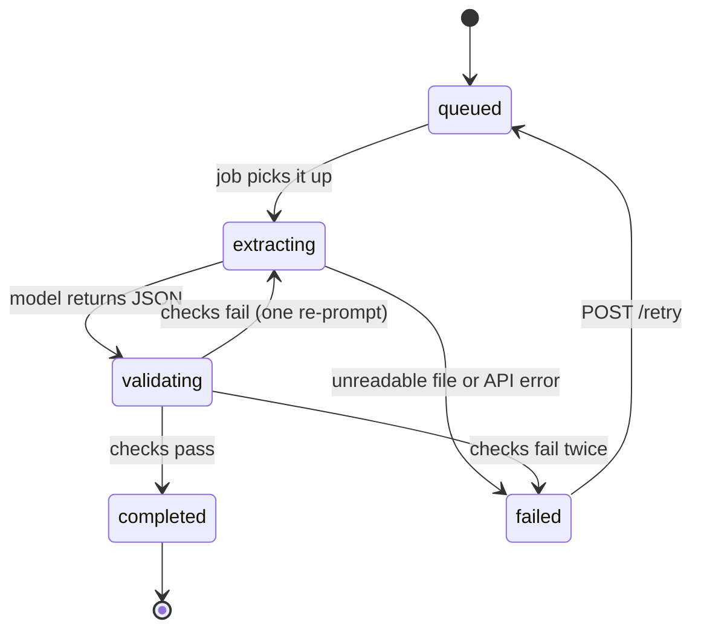

# Document Extraction API: Data Model and Endpoints

Oct 16, 2026 · @Dean Hildebrand

## MVP scope

Ship 10 of the 28 endpoints and 9 of the 10 tables in two weeks, deployed and public. The rest of this spec stays as the roadmap for the README.

| Area | In the MVP | Later |
| --- | --- | --- |
| Tables | organizations, api\_keys, documents, extractions, extraction\_results, events, webhook\_endpoints, webhook\_deliveries, idempotency\_keys | extraction\_schemas (one built-in invoice schema lives as a JSON Schema file in the repo) |
| Documents | `POST /documents`, `GET /documents/:id` | list, download, delete |
| Extractions | `POST /extractions`, `GET /extractions`, `GET /extractions/:id`, `GET /extractions/:id/result`, `POST /extractions/:id/retry` | cancel |
| Webhooks | `POST /webhook_endpoints`, `POST /webhook_endpoints/:id/test`, `GET /webhook_endpoints/:id/deliveries` | list, update, delete, redeliver, auto-disable after repeated failures |
| Schemas | none | all five endpoints |
| Keys and usage | API key created by a seed or rake task | `/api_keys` endpoints, `/usage` |
| Events | written as an outbox to drive webhooks | `GET /events` polling feed |
| Extractors | `Extractors::ClaudeVision` behind the adapter interface | `Extractors::TextractPlusLlm` (interface stub only) |
| Stack | Rails 8 API, PostgreSQL, Sidekiq + Redis, RSpec, Active Storage (S3 in production) | admin UI |

## Build plan

Three weeks at 2 to 3 hours a day, after daily live coding practice. Weeks 1 and 2 build the API; week 3 is the TypeScript companion that consumes its webhooks. Build with Claude Code and keep notes on what you accepted, rejected and fixed.

### Week 1 (from 10 Nov): core pipeline

- [ ] `rails new --api` with PostgreSQL, RSpec, Sidekiq; Postgres and Redis in Docker Compose
- [ ] `organizations` and `api_keys`: bearer token auth with digest lookup; seed task prints one key
- [ ] Tenancy: every query scoped through the current organization; request spec proving org A cannot read org B's document
- [ ] `POST /documents` with Active Storage: PDF/PNG/JPEG only, 20 MB max, SHA-256 checksum
- [ ] `extractions` state machine (queued, extracting, validating, completed, failed); illegal transitions raise
- [ ] `Extractors::ClaudeVision` behind the adapter interface, using the built-in invoice JSON Schema
- [ ] `ExtractionJob` in Sidekiq: call the extractor, save data, model and token counts to `extraction_results`
- [ ] Validation: JSON Schema check, line items sum to the total, VAT matches the rate; one re-prompt on failure, then `failed` with an `error_code`
- [ ] `POST /extractions`, `GET /extractions/:id`, `GET /extractions/:id/result`, `POST /extractions/:id/retry`
- [ ] Specs for models, requests and the job, with the Anthropic call stubbed (WebMock or VCR)

Checkpoint: upload an invoice with curl, poll, get valid JSON back.

### Week 2 (from 17 Nov): production behaviour

- [ ] `events` as a transactional outbox, written in the same transaction as each status change
- [ ] `webhook_endpoints` and `webhook_deliveries`: HMAC signature with timestamp, `DeliveryJob` with exponential backoff and an attempt cap
- [ ] `POST /webhook_endpoints`, `POST /webhook_endpoints/:id/test`, `GET /webhook_endpoints/:id/deliveries`
- [ ] `Idempotency-Key` on POST endpoints: replay the stored response on repeat, 422 when the same key arrives with a different body
- [ ] Cursor pagination and status filter on `GET /extractions`
- [ ] rack-attack rate limit per organization, 429 with `Retry-After`
- [ ] One consistent error JSON shape across all endpoints
- [ ] GitHub Actions: RSpec, RuboCop and Brakeman on every push
- [ ] Deploy (Kamal to a small VPS, or Render) with Postgres, Redis and a Sidekiq worker; `GET /up` health check
- [ ] README: what it does, curl quickstart, architecture diagram, trade-offs table, what you'd build next, AI-assisted development notes

Checkpoint: public URL, green CI, and a README a stranger can follow in 5 minutes.

### Week 3 (from 24 Nov): TypeScript companion

- [ ] Node + Express webhook receiver in TypeScript: verify the signature, reject stale timestamps, dedupe by event id
- [ ] Small React + TypeScript page that uploads a file to the API and lists results the receiver stored (SQLite)
- [ ] Vitest tests for the signature check and dedupe
- [ ] Deploy and link the two repos from each README

Checkpoint: upload in the browser, watch the extracted data arrive by webhook.

## Interview payoff

After the build you should be able to explain each of these in two minutes, with the code open, as decisions you made yourself.

| Question an interviewer asks | Your answer comes from |
| --- | --- |
| How do you keep tenants' data separate? | Organization scoping and the cross-tenant request spec |
| What happens if a job fails halfway? | State machine, retry endpoint, `error_code`, Sidekiq retries |
| How do you stop duplicate requests creating duplicate work? | Idempotency keys and request fingerprints |
| How do you guarantee a webhook fires after a status change? | Transactional outbox in `events` |
| How does a client trust your webhook? | HMAC signing, timestamps, replay rejection on the TypeScript side |
| How do you know the LLM output is right? | JSON Schema plus arithmetic checks and one re-prompt |
| Why not OCR first? | Vision returns data, not positions; Textract is for when you need coordinates, as at GoCanvas |
| How would this scale to 1M documents a day? | Your system design practice, starting from this architecture |
| How do you work with AI tools? | Your README notes on what you accepted, rejected and fixed |

## Overview

A multi-tenant JSON API: clients upload a PDF or image, request an extraction against a schema (invoice, receipt, or their own), and get structured JSON back via webhook or polling.

**Request lifecycle**

1. Client uploads a document (`POST /v1/documents`), gets a document id back immediately.
2. Client creates an extraction (`POST /v1/extractions`) with a schema id. API returns `202 Accepted` with status `queued`.
3. A background job sends the file directly to Claude (vision) with the schema as a tool definition, and gets structured JSON back in one call.
4. The result passes JSON Schema validation and business-rule checks (line items sum to the total, VAT matches its rate), gets one re-prompt on failure, is stored, and the extraction moves to `completed`.
5. An event is written in the same transaction, and a webhook delivery job sends it to the client's endpoints.

**Extractor adapter:** extraction sits behind one interface, `Extractors::Base#call(document, schema)`. `Extractors::ClaudeVision` is the default and ships first. `Extractors::TextractPlusLlm` is the optional second adapter, for documents where exact field positions matter.

**Stack:** Rails 8 API mode, PostgreSQL, Active Storage on S3, Anthropic API, Sidekiq, Redis, RSpec, GitHub Actions, deployed with Kamal or on Render.

## Data model

Ten tables. Every tenant-owned table carries `organization_id`, and every query goes through the current organization. UUID primary keys on anything exposed in the API.

| Table | Key columns | Relationships | Indexes and constraints |
| --- | --- | --- | --- |
| `organizations` | name, slug, plan, rate\_limit\_per\_minute | has many of everything below | unique slug |
| `api_keys` | name, prefix, token\_digest, scopes (array), last\_used\_at, revoked\_at | belongs to organization | unique prefix; token stored only as a digest |
| `extraction_schemas` | name, document\_type, version, json\_schema (jsonb), active | belongs to organization (null = built-in) | unique \[organization\_id, name, version\] |
| `documents` | filename, content\_type, byte\_size, checksum\_sha256, page\_count, metadata (jsonb), Active Storage file | belongs to organization, api\_key; has many extractions | \[organization\_id, created\_at\]; \[organization\_id, checksum\_sha256\] for dedupe |
| `extractions` | status, attempts, llm\_model, error\_code, error\_message, queued\_at, started\_at, finished\_at | belongs to document, extraction\_schema; has one result | \[organization\_id, status, created\_at\]; check constraint on status values |
| `extraction_results` | data (jsonb), validation\_errors (jsonb), extractor, model, prompt\_version, input\_tokens, output\_tokens | belongs to extraction | unique extraction\_id |
| `events` | type, subject\_type, subject\_id, payload (jsonb) | belongs to organization; has many webhook\_deliveries | \[organization\_id, created\_at\] (transactional outbox) |
| `webhook_endpoints` | url, secret, event\_types (array), enabled, consecutive\_failures, disabled\_at | belongs to organization | \[organization\_id, enabled\] |
| `webhook_deliveries` | status, attempts, response\_code, response\_body\_excerpt, next\_attempt\_at, delivered\_at | belongs to event, webhook\_endpoint | unique \[event\_id, webhook\_endpoint\_id\]; \[status, next\_attempt\_at\] |
| `idempotency_keys` | key, request\_fingerprint, response\_status, response\_body (jsonb), locked\_at, expires\_at | belongs to organization | unique \[organization\_id, key\] |

Schemas are versioned rather than edited in place, so a past extraction always points at the exact schema it ran against.

## Extraction state machine

MVP states:



Transitions happen in one place (an `Extraction#transition_to!` method with a row lock), so two workers can never move the same extraction at once. Each transition writes an event, which feeds the webhooks. Non-retryable errors, such as an unreadable file or a result that fails schema validation twice, go straight to `failed`.

## Endpoints (v1)

All under `/v1`, JSON only, Bearer token auth. Every `POST` accepts an `Idempotency-Key` header.

| Method | Path | Purpose | Returns |
| --- | --- | --- | --- |
| POST | `/documents` | Upload a file (multipart `file` field, PDF/PNG/JPEG; limits below) | 201 document, 422 if rejected |
| GET | `/documents` | List, cursor paginated, filter by created\_after | 200 list |
| GET | `/documents/:id` | Document metadata | 200 document |
| GET | `/documents/:id/download` | Short-lived signed URL to the file | 302 redirect |
| DELETE | `/documents/:id` | Delete file and its extractions | 204 |
| POST | `/extractions` | Start extraction: `document_id`, `schema_id` | 202 extraction (queued) |
| GET | `/extractions` | List, filter by status, document\_id | 200 list |
| GET | `/extractions/:id` | Status, timings, error if failed | 200 extraction |
| GET | `/extractions/:id/result` | Structured data plus validation report | 200 result, 409 if not completed |
| POST | `/extractions/:id/cancel` | Cancel while queued | 200, 409 if already running |
| POST | `/extractions/:id/retry` | Re-run a failed extraction | 202 |
| GET | `/schemas` | Built-in plus organization schemas | 200 list |
| POST | `/schemas` | Create a schema (validated as JSON Schema) | 201 schema |
| GET | `/schemas/:id` | Schema with version history | 200 schema |
| PATCH | `/schemas/:id` | Creates a new version | 200 schema |
| DELETE | `/schemas/:id` | Deactivate (soft) | 204 |
| GET | `/webhook_endpoints` | List endpoints | 200 list |
| POST | `/webhook_endpoints` | Register URL and event types; secret shown once | 201 endpoint |
| PATCH | `/webhook_endpoints/:id` | Change URL, events, re-enable | 200 endpoint |
| DELETE | `/webhook_endpoints/:id` | Remove | 204 |
| POST | `/webhook_endpoints/:id/test` | Send a signed `ping` event | 202 |
| GET | `/webhook_endpoints/:id/deliveries` | Delivery log with response codes | 200 list |
| POST | `/webhook_deliveries/:id/redeliver` | Manual retry | 202 |
| GET | `/events` | Event feed for clients that poll instead of using webhooks | 200 list |
| GET | `/api_keys` | List keys (prefix only) | 200 list |
| POST | `/api_keys` | Create key; full token shown once | 201 key |
| DELETE | `/api_keys/:id` | Revoke | 204 |
| GET | `/usage` | Documents, pages and tokens this billing period | 200 usage |

### Upload limits and errors

`POST /documents` detects the content type from the file's bytes and ignores the type the client declares. A rejected upload stores nothing.

| Type | Max size | Max pages |
| --- | --- | --- |
| PDF | 20 MB | 20 |
| PNG | 7 MB | 1 |
| JPEG | 7 MB | 1 |

Every rejection is a 422 with type `invalid_request` and `param: "file"`. Checks run in the order listed and the first failure is reported.

| Code | When | Example message |
| --- | --- | --- |
| `parameter_missing` | No `file` field, or the field holds text rather than an upload | The file parameter is required. |
| `unsupported_file_type` | The bytes are not a PDF, PNG or JPEG | The file must be a PDF, PNG or JPEG. |
| `file_too_large` | Over the size limit for its type | PNG files must be 7 MB or smaller. |
| `unreadable_file` | A PDF that cannot be parsed (including an encrypted one), or an image that does not fully decode | The file could not be read as a PNG. |
| `too_many_pages` | A PDF with more than 20 pages | PDF files must have 20 pages or fewer. |

Outside `/v1`: `GET /up` health check and `GET /docs` for the OpenAPI spec.

## Webhooks

Events are written to `events` in the same transaction as the state change (transactional outbox), then a job fans them out to each subscribed endpoint. No event is lost if the job queue or the client is down.

**Event types:** `extraction.completed`, `extraction.failed`, `document.deleted`, `ping`

**Payload**

```json
{
  "id": "evt_01J...",
  "type": "extraction.completed",
  "created_at": "2026-10-16T17:02:11Z",
  "data": { "extraction_id": "ext_01J...", "document_id": "doc_01J...", "status": "completed" }
}
```

The payload carries ids, not the extracted data. Clients fetch the result with their API key, so sensitive data never sits in delivery logs.

**Signing:** header `X-Signature: t=<unix time>,v1=<hex>` where `v1` is HMAC-SHA256 of `"<t>.<raw body>"` with the endpoint secret. Clients reject anything older than 5 minutes to block replays.

**Retries:** any non-2xx or a 10 second timeout is a failure. Up to 6 attempts with backoff of 1 min, 5 min, 30 min, 2 h, 8 h. After 20 consecutive failed deliveries the endpoint is disabled and the organization can re-enable it via `PATCH`.

**Ordering:** not guaranteed. Each payload has `created_at`, and clients treat `id` as an idempotency key.

## Cross-cutting rules

| Concern | Approach |
| --- | --- |
| Auth | `Authorization: Bearer dx_live_<prefix>_<secret>`. Look up by prefix, compare a SHA-256 digest with `secure_compare`. Scopes: `documents:write`, `extractions:read`, `webhooks:manage`, `keys:manage`. |
| Tenancy | `Current.organization` set from the key. Controllers only reach records through `Current.organization.documents` and so on, never `Document.find`. A request spec per resource proves organization A gets 404 on organization B's ids. |
| Rate limiting | Per API key, Redis token bucket via Rack::Attack, limit from `organizations.rate_limit_per_minute`. Return 429 with `Retry-After` and `X-RateLimit-Remaining` headers. |
| Idempotency | `Idempotency-Key` on POST stores fingerprint and response for 24 h. Same key, same body: replay stored response. Same key, different body: 422. Concurrent duplicate: 409 while `locked_at` is set. |
| Errors | One shape everywhere: `{"error": {"type": "invalid_request", "code": "schema_not_found", "message": "...", "param": "schema_id"}}`. Types: `authentication`, `permission`, `invalid_request`, `not_found`, `conflict`, `rate_limited`, `internal`. |
| Pagination | Cursor based on `(created_at, id)`: `?limit=25&starting_after=<id>`, response has `data`, `has_more`, `next_cursor`. Stable under inserts, unlike offset. |
| Versioning | Path versioned (`/v1`), serializers per version so v2 can change shapes without touching v1. |
| Observability | Request id on every response and log line, structured JSON logs, job duration and failure metrics. |

## Trade-offs for the README

These are the decisions an interviewer will probe. Write each up as choice, alternative, and why.

| Decision | Chosen | Alternative | Why |
| --- | --- | --- | --- |
| Processing model | Async jobs, 202 + webhook | Synchronous response | OCR plus LLM takes 5 to 60 s; holding requests open ties up Puma threads |
| Event delivery | Transactional outbox | `after_commit` enqueue | Enqueue can fail after commit and silently drop the event |
| Tenant isolation | App-level scoping + isolation specs | Postgres row-level security | Simpler to read and test; RLS noted as the next hardening step |
| Pagination | Cursor | Offset | Stable results while new documents arrive; no slow deep offsets |
| Schema changes | Immutable versions | Edit in place | Old results stay reproducible and auditable |
| Webhook payload | Ids only | Full extracted data | Keeps sensitive data out of delivery logs and client request logs |
| Job backend | Sidekiq | Solid Queue | Solid Queue is the Rails 8 default and needs no Redis; Sidekiq is what most Rails shops run and what retries and idempotency questions assume |
| Extraction method | Direct Claude vision | Textract OCR, then LLM | The API returns data, not positions, so one call beats two services. Textract wins when fields must be highlighted on the source document; the adapter keeps that option open |

**Open questions**

- [ ] Hosted demo: cap usage with a demo key and page limit so a public link cannot run up AWS costs?
- [ ] Ship a tiny React or Hotwire dashboard for the webhook log, or keep it pure API?
- [ ] Add an optional Python extraction service behind the adapter interface later?
